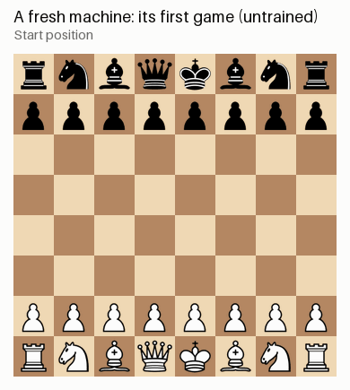
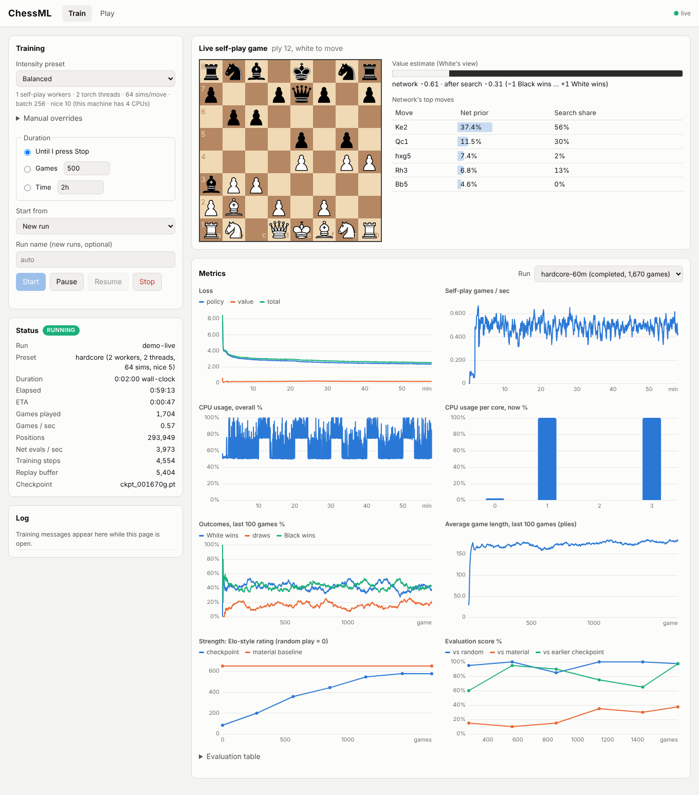
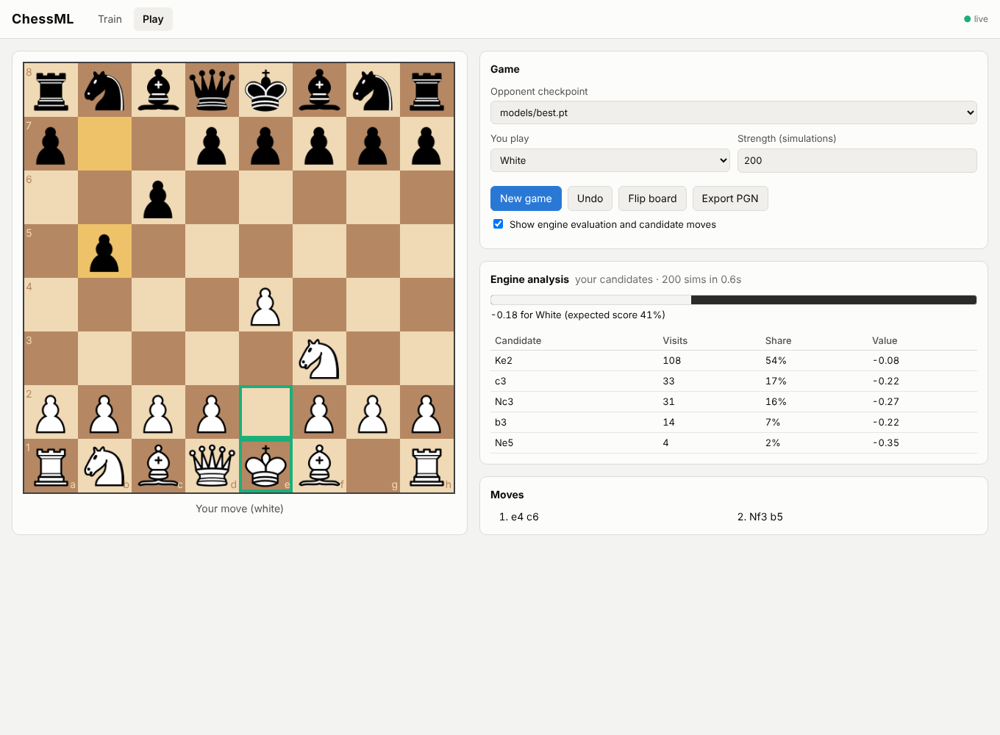
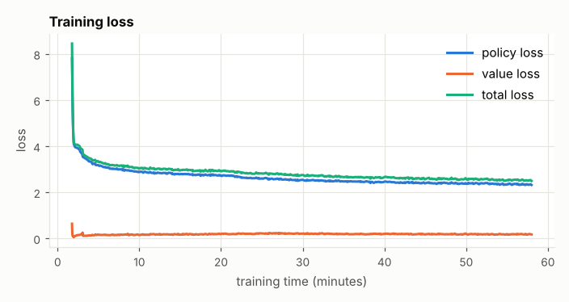
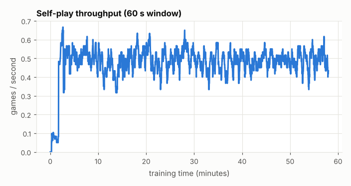
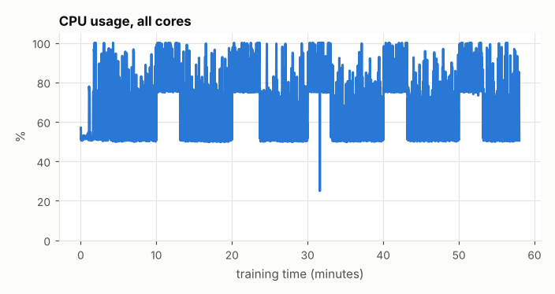
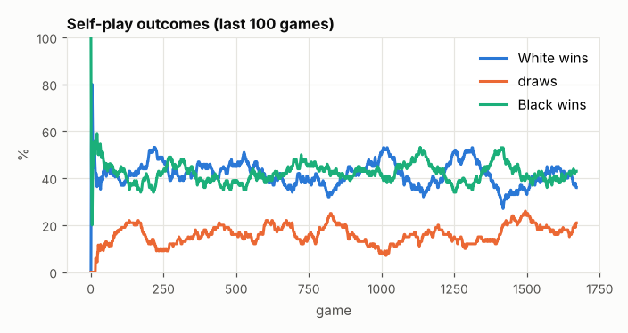
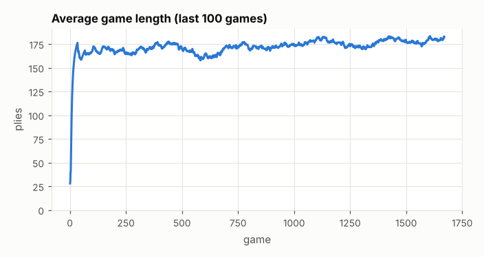
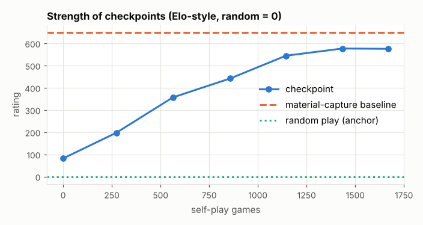

# ChessML

A chess engine that learns by playing against itself, built to train on a
CPU-only machine. A local web interface lets you start and control training,
watch it live, and play against any checkpoint.

- **AlphaZero-style learning:** a residual policy/value network in PyTorch,
  guided by Monte Carlo tree search (MCTS). It knows only the rules, which
  come from [python-chess](https://python-chess.readthedocs.io/).
- **Training control:** set the length by number of games, by wall-clock time,
  or "until I press Stop". You can pause, resume and stop gracefully, and
  resume from any run or checkpoint.
- **Intensity presets** (Light / Balanced / Heavy / Hardcore) that scale with
  your core count, plus manual overrides.
- **Training against Stockfish** (optional): mix games against a local
  Stockfish into self-play. The network learns from Stockfish's best moves,
  and the engine's strength adapts to the network's results.
- **Live dashboard** over WebSocket: losses, throughput, CPU per core, outcomes,
  game length, Elo-style strength, and the self-play game in progress with
  the network's move probabilities and value estimate.
- **Play mode:** a clickable board, a choice of colour, checkpoint and strength,
  undo, flip, PGN export and optional engine analysis.
- **Strength in Elo:** a Strength tab calibrates against Stockfish's
  Elo-rated mode and measures any checkpoint, with a 95% interval.

## Watch it play

| A fresh machine: its first game | After 24 hours of training |
|---|---|
|  | <!-- 24h GIF placeholder: replace this cell with  --> *Placeholder: rendered after a 24-hour run, see below.* |

Both games are the network against itself, from the start position, under
the training rules (200-ply limit, then material adjudication). The fresh
machine is an untrained network, the `ckpt_000000g.pt` that every new
machine starts as. Its moves are close to random, and this game drifted into
a draw by repetition after 168 plies. To render the right-hand game:

```bash
python -m chessml train --preset hardcore --time 24h --name machine-24h
python -m chessml gif machine-24h --title "After 24 hours of training" --out docs/games/machine-24h.gif
```

`gif` takes any checkpoint, run name or label, and can play against an
opponent instead of itself: `--opponent random`, `material`, `sf-level-N`
or `sf-elo-N` (Stockfish), or another checkpoint file.

## How it works

```
             +--------------------- trainer process ----------------------+
             |  replay buffer (last 100k positions)                       |
 games  ---> |  AdamW on  policy cross-entropy + value MSE                |
 (planes,    |  publishes new weights every 25 steps  ------------------+ |
  visit      |  checkpoint every 10 min, evaluation every 15 min        | |
  counts,    +----------------------------------------------------------|-+
  result)          ^                                                     |
                   |                                                     v
       +-----------+-----------+   ... one per worker ...   +-----------------------+
       | self-play worker 0    |                            | self-play worker N-1  |
       | 16 games at once,     |                            |                       |
       | batched MCTS, 64 sims |                            |                       |
       +-----------------------+                            +-----------------------+

 web server (FastAPI, not niced)  <-- events (mp.Queue) --  trainer
        |  WebSocket push
        v
 browser: controls, live charts, live board, play mode
```

1. **Encode** the position from the side to move's view: 20 planes of 8x8 for
   pieces, castling rights, en passant, the 50-move counter and repetition.
2. **Search.** Each worker plays 16 games at once. Every MCTS round picks one
   leaf per game, and the network scores all 16 leaves in a single batch. That
   gives policy priors over the 4,672 AlphaZero move slots and a value in
   [-1, 1]. The search selects moves by PUCT and reuses the tree between
   moves. The search effort is randomised per move (playout cap
   randomisation, from KataGo): a quarter of the moves get the full 64
   simulations with Dirichlet noise at the root. The rest get a quick
   16-simulation search that only picks the move.
3. **Play.** Moves are sampled from visit counts for the first 20 plies, then
   the most-visited move is played. A game ends by checkmate, stalemate,
   insufficient material, the 50-move rule or threefold repetition. At 200
   plies it is adjudicated: a lead of at least 3 pawns of material wins,
   anything less is a draw. A side resigns when two full searches in a row
   value its position below the resignation threshold (from ply 20; at most
   -0.9). One game in ten is played out anyway and reports how low each
   side's value went and whether it lost. As in AlphaZero, the threshold is
   set from these games: the highest value at which no more than 5% of the
   sides that fell below it went on not to lose. If no value qualifies,
   resignation switches off until the games say otherwise.
4. **Learn.** Every fully searched position becomes a training sample: the
   visit distribution is the policy target, and the game result (from that
   position's side to move) is the value target. The trainer samples each
   position about 4 times, then sends the new weights to the workers. When
   three evaluations in a row find no checkpoint better than the best so
   far, the learning rate drops to 30% (down to 1e-5).
5. **Measure.** A separate process regularly plays the newest checkpoint
   against three opponents: a random mover, a greedy material-capture
   baseline, and the previously evaluated checkpoint. Ratings are fitted on
   an Elo scale with random play anchored at 0. After a one-off calibration
   against Stockfish they become real Elo (see
   [Measuring strength in Elo](#measuring-strength-in-elo)).

### Sizing for a CPU

- **Network: 4 residual blocks x 48 channels, 265,994 parameters.** On a CPU,
  each search step pays twice: once for Python tree work (move generation,
  encoding, selection) and once for the network call. At this size the
  network call costs about as much as the tree work around it, so neither
  dominates. Measured once on the machine of the reported run (one worker,
  one thread, 16 parallel games, 64 simulations per move):

  | Network | Parameters | Network evaluations/s |
  |---|---|---|
  | 4 x 32 | 157,818 | 2,554 |
  | **4 x 48** | **265,994** | **1,810** |
  | 5 x 64 | 489,626 | 1,239 |
  | 6 x 64 | 563,610 | 1,079 |
  | 8 x 96 | 1,504,442 | 479 |
  | 10 x 128 | 3,201,498 | 264 |

  With hours of CPU rather than months of TPU, more games beat more
  capacity. 4x48 costs about 30% of throughput against 4x32, for 70% more
  parameters.
- **Search: 64 simulations on a quarter of the moves, 16 on the rest, 16
  games batched per worker.** 64 simulations are enough for the visit counts
  to improve on the raw policy. Searching only the training samples that
  deeply plays more games per CPU hour, and the value head learns from game
  results, so more games is what it needs. Batching across games (instead of
  virtual loss inside one tree) keeps every search exact and amortises the
  per-call overhead of PyTorch. About half of a worker's time is the
  network's convolutions, so inference runs in the channels-last memory
  layout, which is about 25% faster on a CPU for these small batches.
- **Move limit with adjudication.** An untrained network almost never
  delivers mate, so with only game results to learn from the value head
  would see mostly draws. Scoring long games by material gives it a learning
  signal from the first minutes. Checkmates take over as the network gets
  stronger.

## Install

Developed and tested with Python 3.14.6 on Linux. No GPU is needed.

```bash
git clone https://github.com/PharellJay/ChessML.git
cd ChessML
python3.14 -m venv .venv
source .venv/bin/activate
python -m pip install --upgrade pip

# 1. PyTorch, CPU-only build: a much smaller download without the CUDA libraries
pip install torch==2.15.0 --index-url https://download.pytorch.org/whl/cpu

# 2. Everything else (pinned versions)
pip install -r requirements.txt

# 3. Check the install
python -m pytest -q
```

If you skip step 1, `pip install -r requirements.txt` installs the default
PyPI build of torch. That build bundles CUDA, also runs fine on a CPU-only
machine, and is the one used for the results below, but it downloads
several GB.

The web interface needs no build step and no internet access: chessboard.js,
chess.js, jQuery and the piece images are vendored in `chessml/static/vendor/`.

## Quick start

```bash
python -m chessml serve            # opens http://127.0.0.1:8000/
```

In the browser, pick a preset, pick a duration and press **Start**. Charts and
the live board update as training runs. The **Play** tab plays against any
checkpoint, including the bundled `models/best.pt`, right after cloning.

The same from the terminal:

```bash
python -m chessml train --preset balanced --time 2h      # wall-clock limit
python -m chessml train --preset heavy --games 2000      # game limit
python -m chessml train --preset light                   # until Ctrl+C
python -m chessml train --resume run-20261029-101500     # continue a run
python -m chessml train --resume runs/x/checkpoints/ckpt_000500g.pt   # new run from a checkpoint
python -m chessml train --preset heavy --engine-share 0.5 --time 1h   # half the games vs Stockfish
python -m chessml evaluate run-20261029-101500 --games 40
python -m chessml calibrate                              # once: Elo ladder against Stockfish
python -m chessml elo models/best.pt                     # Elo of a checkpoint
python -m chessml gif models/best.pt --opponent material # one game as an animated GIF
python -m chessml list                                   # presets, runs, checkpoints
python -m chessml report --run run-20261029-101500       # regenerate Results below
```

## Training modes and intensity presets

**Duration.** Set exactly one of `--games N`, `--time 2h` (also `90m`,
`1h30m`, `45s`), or nothing, which means until stopped. Limits apply to the
current session: resuming a run with `--games 500` plays 500 more. Paused
time does not count against a time limit. While a limited run is going, the
dashboard shows its ETA.

**Stopping.** Stop, the UI button, or Ctrl+C in the terminal running `train`
or `serve`, ends training gracefully: games still in progress are discarded,
games already finished are kept, and a checkpoint and the replay buffer are
saved. A second Ctrl+C quits immediately. Pause freezes self-play,
training and any running evaluation, and resume continues where it left off.

**Resuming.** `--resume <run>` continues that run in place from its latest
checkpoint: weights, optimiser, counters, replay buffer, and metrics appended
to the same charts. `--resume <file.pt>` starts a new run initialised from
that checkpoint. In the web interface a run is called a **machine**: pick
one and Start continues it. *New machine* creates one, either untrained or
starting from a copy of any checkpoint (*Fork* on a checkpoint does the
same).

**Intensity.** Presets are computed from the number of logical CPUs:

| Preset | Self-play workers | Trainer threads | Sims/move | Batch | Niceness | Replay buffer | On 4 CPUs | On 12 CPUs |
|---|---|---|---|---|---|---|---|---|
| Light | cpus / 6 | 1 | 64 | 128 | 19 | 100k (~180 MB) | 1 + 1 | 2 + 1 |
| Balanced | cpus / 3 | 2 | 64 | 256 | 10 | 100k (~180 MB) | 1 + 2 | 4 + 2 |
| Heavy | 2 x cpus / 3 | 2 | 64 | 256 | 8 | 300k (~530 MB) | 2 + 2 | 8 + 2 |
| Hardcore | cpus - 2 | 2 | 64 | 256 | 5 | 300k (~530 MB) | 2 + 2 | 10 + 2 |

The last two columns are workers + trainer threads. Each worker keeps one
core busy, so Hardcore uses every core: 10 workers plus 2 trainer threads on
a 12-core machine, plus a short-lived evaluation process every 15 minutes.
The heavier presets produce positions about three times as fast, so their
replay buffer keeps three times as many. Override any value with
`--workers`, `--threads`, `--sims`, `--batch-size`, `--nice` and
`--buffer-size`, or in the UI under *Manual overrides*.
`--full-search-prob`, `--fast-sims` and `--resign-threshold` (-1 turns
resignation off) tune the search effort and resignation. `python -m chessml list`
prints the presets for your machine.

**Why the UI stays responsive.** Trainer, workers and evaluator are separate
processes that lower their own priority (niceness 5 to 19). The web server
stays at normal priority and only relays events, so the kernel schedules it
ahead of training even when every core is busy.

### Training against Stockfish

Self-play starts from nothing: an untrained network only learns from games
between two equally clueless players. Games against an established engine
give it a teacher. ChessML runs [Stockfish](https://stockfishchess.org/)
locally rather than through an online API. The free chess APIs (Lichess's
Stockfish AI via its Bot API, chess-api.com and the like) are rate-limited
and play in real time, which means a few games a minute. Training needs
thousands. A local Stockfish is the same engine, free, offline and as fast
as the CPU allows.

```bash
sudo apt install stockfish        # Ubuntu/Debian; or download from stockfishchess.org
python -m chessml train --preset heavy --engine-share 0.5 --time 1h
```

ChessML looks for the engine in `--engine-path`, then `$CHESSML_ENGINE`,
then `stockfish` on the PATH (including `/usr/games/stockfish`). Any UCI
engine that supports MultiPV works.

- **The mix.** `--engine-share 0.5` makes each new game a game against
  Stockfish with probability 50%. The rest stay self-play. `1` means engine
  games only, `0` (the default) means pure self-play. In the UI, choose
  *Mode: Self-play + games against Stockfish*. In an engine game the network
  plays a random colour. Each worker starts its own single-threaded Stockfish
  at the worker's niceness.
- **What the network learns.** On the network's moves: the MCTS visit
  counts, as in self-play. On Stockfish's moves: one multi-PV search
  (`--engine-nodes`, 5,000 nodes by default) gives its 5 best moves. A softmax over
  their scores becomes the policy target. Every position's value target is
  the game result. The target is always Stockfish's *best* moves, not the
  weakened move it plays, so the network never imitates a deliberate
  mistake. `--no-imitate` trains on the network's own moves only.
- **Strength levels 0-20.** Level 0 plays random moves. The share of
  random moves falls to zero at level 10. Above that, Stockfish picks among
  its candidates by a softmax over their scores, and the temperature falls
  to zero at level 20, where it always plays its best move. The level is
  ChessML's own scale, not Stockfish's `Skill Level`, and the top level is
  still limited by the short search. The search is limited by nodes, not
  time, exactly like the Elo ladder's Stockfish levels, so the strength does
  not depend on the CPU's load, and with an Elo calibration the status
  panel and the log show each level's Elo (for example "level 7 ≈ 677 Elo").
- **Adaptive level.** After every 20 engine games at the current level, a
  score of 60% or more raises the level by one, and 30% or less lowers it.
  `--engine-level N` sets the starting level, and `--engine-fixed` keeps it
  there. The level is saved with each checkpoint, so `--resume` continues
  from it. The dashboard charts the network's score against Stockfish and
  the level game by game.

## Measuring strength in Elo

Without a reference, ratings are relative: random play is 0 and everything
else is measured against it. To get Elo, ChessML uses Stockfish's
strength-limited mode (`UCI_LimitStrength` / `UCI_Elo`). The Stockfish
team calibrated that mode against the CCRL 40/4 rating list, and it covers
1320 to 3190.

```bash
python -m chessml calibrate                 # once per machine / Stockfish version
python -m chessml elo models/best.pt        # any checkpoint, run name or label
```

Both also run from the web interface's **Strength** tab (see the
[UI tour](#ui-tour)). Measurements from either place are kept in
`runs/elo_results.json` and listed there.

**The ladder.** A young network is far below 1320, so a single match
against the weakest Stockfish setting only says "loses every game". A
ladder of bridge players closes the gap, from weakest to strongest:

- random moves
- Stockfish at training strength levels 3, 5 and 6 (see above)
- the greedy material player
- Stockfish at levels 7, 8, 9, 10, 12 and 15
- `UCI_Elo` 1320, 1600 and 1900

The ladder is densest where the network spends most of its training. A
step of one level near the bottom means one random move in ten more or
less, which is worth 100-200 Elo.

`calibrate` plays each player against its two nearest neighbours on the
ladder, and the seven strongest bridges against each `UCI_Elo` anchor, 20
games per match (800 games). A maximum-likelihood fit with the anchors fixed
at their nominal Elo then rates every bridge, random play included.

**Refinement.** Below 1320, every rating hangs on a chain of matches down
from the anchors, so its uncertainty grows towards the bottom of the
ladder, which is exactly where young networks are measured. A second round
of the same size therefore picks its matches by plan. A game's information
depends only on the expected score, so the plan can be made before playing.
It greedily adds, 20 games at a time, the pairing (played before or new)
that most reduces the mean variance of the ladder players below the lowest
anchor. In practice that means many more games for the weak link between
Stockfish level 9 and the 1320 anchor, and new pairings across the lower
ladder. Planned from the first round's results, the 800 extra games were
predicted to bring the ladder players below 1200 from ± 215 to ± 109 on
average (root mean square), against ± 152 for doubling every match. On the
machine of this README the refinement delivered exactly that, ± 109:

| | first round (800 games) | + planned refinement (800 games) |
|---|---|---|
| Stockfish level 9 | 1041 ± 132 | 1071 ± 55 |
| material player | 608 ± 188 | 590 ± 104 |
| random moves | -182 ± 312 | -213 ± 162 |
| `models/best.pt`, same 100 measurement games | 435 ± 193 | 481 ± 115 |

Both rounds together take about 4 hours of CPU time, spread over CPUs
minus 2 processes: 26 minutes on 10 processes, about two hours on 2. The
games are saved to `runs/elo_calibration.json`. `calibrate --refine` (or
*Refine* in the Strength tab) adds another planned round to an existing
calibration, and `--refine-games` sets its size (0 skips it).

**Measuring.** `elo` first scouts: 2 games against every calibrated player
give a rough estimate. It then plays 20 games against each player within
350 Elo of that estimate, and at least the 4 nearest. Lopsided matches tell
little and only slow things down. The final fit uses those games plus the
calibration games, and `elo` prints the Elo with a 95% interval. The
interval includes the uncertainty of the bridge ratings. `--games` and
`--sims` change the measurement, and `--opponents` picks the players
yourself, skipping the scouting stage. If the checkpoint belongs to a run,
its games are stored with the run's evaluations. For example, the bundled
`models/best.pt` measured **Elo 483 ± 113** (Stockfish 17.1, refined
calibration). It scored 75% against level 5 (409) and 30% against the
material player (590). A measurement takes about 6 minutes on 10 processes.
`elo` and the Strength tab also say how much of the interval comes from the
measurement's own games, so you know whether more games (`--games`) or a
refinement would narrow it more.

**During training.** Once a calibration exists, the Strength chart, the
status panel, the log and `report` show Elo instead of the relative scale.
Each periodic evaluation first plays its usual opponents, estimates the
checkpoint's Elo from those games, and then plays the two calibrated
Stockfish players just below and just above that estimate, 20 games each
(`--eval-calibrated-games`). A player on each side gives the most
information about a rating in between, so the estimate stays tight as the
network improves. With the default game counts an evaluation takes about 10
minutes of one core.

**What the number means.** Engine moves are limited by node count, not
time, so results do not depend on CPU speed or load. `UCI_Elo` players
search 50,000 nodes per move, which is enough to reach the depth where
Stockfish picks its deliberately weakened move. The scale is CCRL 40/4
engine Elo. It is not FIDE, Lichess or Chess.com, and below about 1000 it
is an extrapolation through the bridge players rather than a measured
calibration. Read it as a reproducible yardstick, accurate to within its interval plus
some systematic error, not as a rating a human would get. Ratings are
plain maximum-likelihood fits. The single virtual draw per pairing that
keeps relative ratings finite would squeeze lopsided calibration pairs
together and inflate the bottom of the ladder by about 150 Elo, so
calibrated fits use only a token 0.01.

## UI tour

**Train tab**



In this screenshot the metrics show the reported `hardcore-60m` run (picked
in the **Run** selector, now called **Machine**). The status panel and live board come from a short
session started from that run's final checkpoint, which is why its counters
continue from 1,670 games.

- *Training* (left): the **machine** to train, with *New machine* and the
  machine's checkpoints. Each checkpoint has *Play* (open it in the Play tab),
  *Elo* (measure it in the Strength tab) and *Fork* (a new machine starting
  from it). Below that: preset with its resolved values, manual overrides,
  mode, duration (until stop / N games / time), and Start / Pause / Resume /
  Stop. Start continues the selected machine from its latest checkpoint.
- *Status*: state, machine, preset, elapsed time, ETA, games played, games/s,
  positions, network evaluations/s, training steps, learning rate,
  resignation (threshold, and how many checked resignations would have been
  wrong), replay buffer size and current checkpoint.
- *Live training games*: a thumbnail of every game in progress, across all
  workers (Stockfish games marked), refreshed once a second. Click one to
  follow it in the large view: the network's value estimate (raw and after
  search) and its top moves (prior probability, and share of search visits).
- *Metrics*: charts for loss (policy, value, total), games/s, overall CPU,
  CPU per core, win/draw/loss and average game length over the last 100
  games, Elo-style rating per evaluated checkpoint, evaluation scores, and,
  for runs with engine games, the network's score against Stockfish and the
  Stockfish level, plus an evaluation table. The **Machine** selector shows the history of
  any machine: metrics are stored per run in SQLite (`runs/<run>/metrics.db`),
  so charts survive restarts.

**Play tab**



A game against the bundled `models/best.pt` with engine analysis switched on.

Click a piece, then its target square. Legal targets are highlighted, and
promotions ask which piece you want. You choose your colour, the checkpoint
to play against, and its strength in MCTS simulations per move. **Undo**
takes back your last move together with the engine's reply. **Export PGN**
shows the game for copying or downloading. *Show engine evaluation* adds the
search value and the top candidate moves (visits, share, value), and outlines
the best candidate on the board. Checkpoints that have been measured show their
Elo in the opponent list.

**Strength tab**

Measures checkpoints in Elo (see
[Measuring strength in Elo](#measuring-strength-in-elo)). Open it directly at
`http://127.0.0.1:8000/#strength`.

- *Calibration*: whether the Elo ladder is calibrated (Stockfish version,
  date, games, duration), Calibrate / Recalibrate, and *Refine*, which adds a
  refinement round to the current calibration. Both show a time estimate.
  Games per match and processes are under *Options*.
- *Measure a checkpoint*: any bundled or trained checkpoint, games per
  opponent, simulations per move and processes.
- *Progress*: the running job's stage (scouting, measuring, calibrating or
  refining), a progress bar, the opponents picked after scouting, every
  finished match, and Cancel. Cancelling stops all match processes within a
  second and keeps the previous calibration.
- *Live games*: while a job runs, a thumbnail of every game in progress
  (all games of the running matches, refreshed once a second). Click one to
  follow it on the large board with both players, the game number and the
  ply.
- *Result*: the Elo with its 95% interval, the two ladder players it falls
  between, how much of the interval comes from the measurement's own games
  and how much from the calibrated ladder (so you know whether more games
  or a refinement would help), and the score against each opponent.
- *Ladder*: every calibrated player and the measured checkpoints on one Elo
  axis, each with its interval. The Stockfish `UCI_Elo` anchors are marked.
- *Measurements*: every measurement so far. Click one to show it above.
  Results are refitted whenever the calibration changes.

One job runs at a time, in its own processes, so the page stays responsive.
It can run alongside training: both get slower, but the result is the same,
because engine moves are limited by nodes and the network by simulations,
not by time.

## Results

The table below states the machine and preset of the run it describes. On a
machine with more cores, Hardcore starts more self-play workers (CPUs minus
2), so it plays more games in the same time. Rerun the commands in
[Reproducing the results](#reproducing-the-results) to regenerate this
section on your own machine.

<!-- results:start -->

Generated by `python -m chessml report` from run `hardcore-60m`.

### The run

| | |
|---|---|
| Hardware | Intel(R) Xeon(R) Processor @ 2.10GHz, 4 logical CPUs, 15.7 GB RAM, GPU: none (CPU only) |
| Software | Linux 6.18.44-fc-v185, Python 3.14.6, torch 2.15.0+cu132 |
| Preset | `hardcore`: 2 self-play workers, 2 trainer threads, 64 simulations/move, batch 256, nice 5 |
| Network | 4 residual blocks x 48 channels |
| Training sessions | 1: preset=hardcore workers=2 0:58:00 wall-clock |
| Training time | 0:58:00 |
| Self-play games | 1,670 (0.48 games/s on average) |
| Positions generated | 288,545 |
| Training steps | 4,509 |
| Network evaluations/s (all workers, median) | 3,124 |
| Loss, first -> last logged | total 8.456 -> 2.497 (policy 7.817 -> 2.323, value 0.639 -> 0.175) |
| Last 100 self-play games | adjudicated 63, checkmate 16, move limit 15, repetition 6; average length 183 plies |

_Hardware details describe the machine that generated this report (the run did not record its own)._

### Strength of the final checkpoint (`ckpt_001670g.pt`)

| Opponent | Games | Wins | Draws | Losses | Score |
|---|---|---|---|---|---|
| random | 40 | 38 | 2 | 0 | 97.5% |
| material | 40 | 5 | 20 | 15 | 37.5% |
| ckpt_000000g.pt | 40 | 38 | 2 | 0 | 97.5% |

Simulations per move in evaluation: 64.

### Elo-style ratings (all evaluation games of the run, random play = 0)

| Player | Rating |
|---|---|
| material | 649 |
| ckpt_001435g.pt | 577 |
| ckpt_001670g.pt | 575 |
| ckpt_001144g.pt | 544 |
| ckpt_000857g.pt | 442 |
| ckpt_000563g.pt | 356 |
| ckpt_000273g.pt | 198 |
| ckpt_000000g.pt | 82 |
| random | 0 |

The bundled `models/best.pt` is `ckpt_001435g.pt`, the best-rated checkpoint (577), saved without optimiser state (1.1 MB).

### Charts








<!-- results:end -->

## Reproducing the results

```bash
# 1. Train: Hardcore preset, 58 minutes of training (under 60 minutes of wall clock in total)
python -m chessml train --preset hardcore --time 58m --eval-minutes 10 --seed 1 --name hardcore-60m

# 2. Final evaluation of the last checkpoint: 40 games each against random, the
#    material-capture baseline and the untrained starting network
python -m chessml evaluate hardcore-60m --games 40 --sims 64 \
    --opponents random,material,previous --previous first --seed 1

# 3. Regenerate the Results section and charts, and export the best checkpoint
python -m chessml report --run hardcore-60m --export-best
```

Self-play runs in several processes, so two runs never play identical games,
and throughput depends on the CPU. Expect the same trend, not the same numbers.

## Project layout

```
chessml/
  encoding.py    board planes, move <-> policy index (4,672 AlphaZero move slots)
  network.py     residual policy/value network, checkpoint save/load
  mcts.py        batched PUCT search with tree reuse
  selfplay.py    self-play worker processes (and engine games), game rules, adjudication
  trainer.py     replay buffer, optimisation, checkpoints, evaluation, graceful stop
  engine.py      Stockfish (UCI) opponent: strength levels, imitation targets, adaptive level
  evaluation.py  random and material-capture baselines, matches, Elo fitting
  elo.py         Elo calibration ladder against Stockfish's UCI_Elo, measuring checkpoints
  metrics.py     per-run SQLite metrics
  runs.py        run directories and checkpoint discovery
  server.py      FastAPI app, WebSocket events, play endpoint
  report.py      charts and the Results section of this README
  gif.py         one game of a checkpoint as an animated GIF
  cli.py         python -m chessml {train,evaluate,calibrate,elo,gif,serve,report,list}
  static/        web UI (plain HTML/CSS/JS) and vendored libraries
models/best.pt   best checkpoint of the reported run (weights only)
tests/           pytest suite
```

## Limitations

- **The strength ceiling is low.** AlphaZero trained for millions of games
  with 800 simulations per move on thousands of TPUs. An hour on a few CPU
  cores gives a few thousand games with a 266k-parameter network. Expect an
  engine that captures material and mates weak opponents, not one that
  plays sound chess. Longer runs keep improving, but slowly.
- **Material adjudication is domain knowledge.** It speeds up early learning,
  but it also teaches the network to value material the way the adjudication
  rule does. Set `--max-plies` high to rely on real game results instead.
- **Ratings are approximate.** Without a calibration they are relative,
  with random play anchored at 0. With one they are CCRL-scale engine Elo,
  extrapolated through bridge players below Stockfish's 1320 floor. Either
  way they come from tens of games per match and carry wide error bars,
  and they are not comparable to FIDE or online ratings.
- **No history planes.** The input encodes only the current position plus a
  repetition flag, unlike AlphaZero's 8-position history.
- **Python search.** The tree search is pure Python, so it scales with
  processes, not threads. On a big machine, more workers help more than more
  threads per worker.
