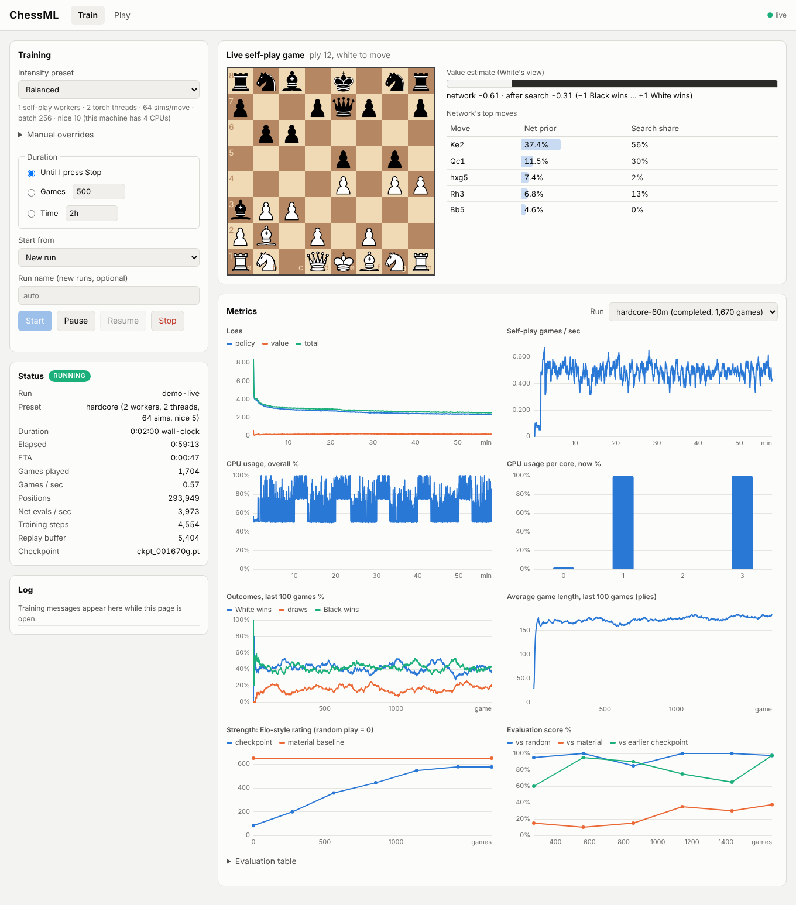
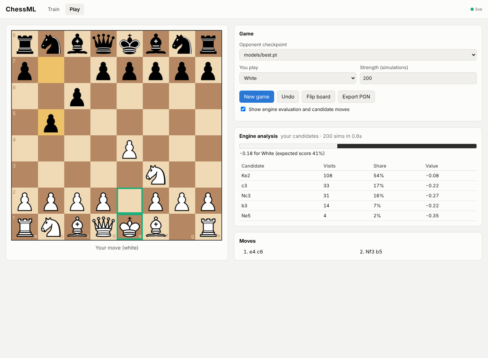
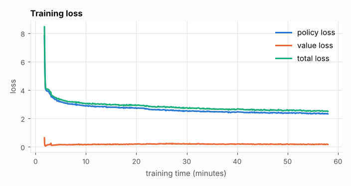
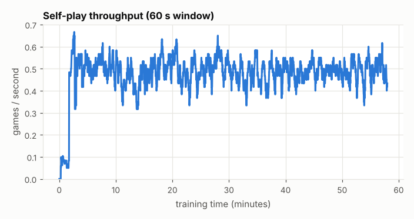
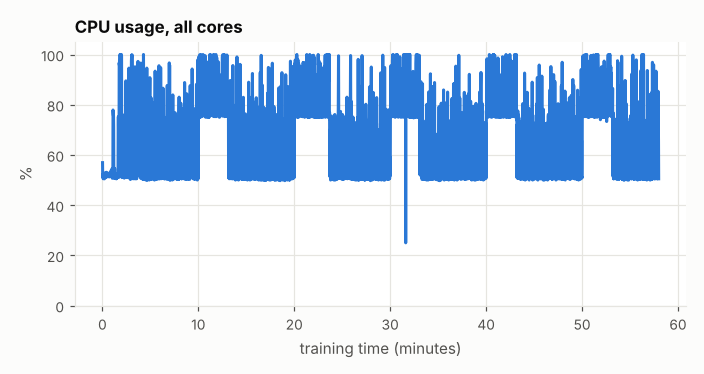
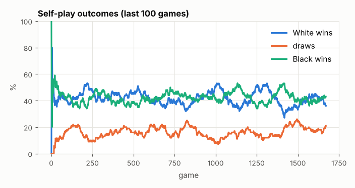
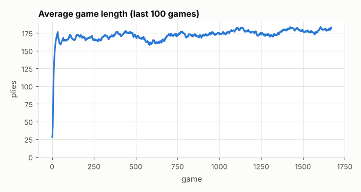
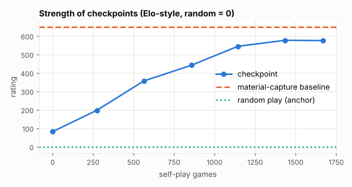

# ChessML

A chess engine that learns by playing against itself, built to train on a
CPU-only machine. A local web interface lets you start and control training,
watch it live, and play against any checkpoint.

- **AlphaZero-style learning:** a residual policy/value network in PyTorch,
  guided by Monte Carlo tree search (MCTS). It knows only the rules, which
  come from [python-chess](https://python-chess.readthedocs.io/).
- **Training control:** set the length by number of games, by wall-clock time,
  or "until I press Stop". You can pause, resume and stop gracefully, and
  resume from any run or checkpoint.
- **Intensity presets** (Light / Balanced / Heavy / Hardcore) that scale with
  your core count, plus manual overrides.
- **Training against Stockfish** (optional): mix games against a local
  Stockfish into self-play. The network learns from Stockfish's best moves,
  and the engine's strength adapts to the network's results.
- **Live dashboard** over WebSocket: losses, throughput, CPU per core, outcomes,
  game length, Elo-style strength, and the self-play game in progress with
  the network's move probabilities and value estimate.
- **Play mode:** a clickable board, a choice of colour, checkpoint and strength,
  undo, flip, PGN export and optional engine analysis.

## How it works

```
             +--------------------- trainer process ----------------------+
             |  replay buffer (last 100k positions)                       |
 games  ---> |  AdamW on  policy cross-entropy + value MSE                |
 (planes,    |  publishes new weights every 25 steps  ------------------+ |
  visit      |  checkpoint every 10 min, evaluation every 15 min        | |
  counts,    +----------------------------------------------------------|-+
  result)          ^                                                     |
                   |                                                     v
       +-----------+-----------+   ... one per worker ...   +-----------------------+
       | self-play worker 0    |                            | self-play worker N-1  |
       | 16 games at once,     |                            |                       |
       | batched MCTS, 64 sims |                            |                       |
       +-----------------------+                            +-----------------------+

 web server (FastAPI, not niced)  <-- events (mp.Queue) --  trainer
        |  WebSocket push
        v
 browser: controls, live charts, live board, play mode
```

1. **Encode** the position from the side to move's view: 20 planes of 8x8 for
   pieces, castling rights, en passant, the 50-move counter and repetition.
2. **Search.** Each worker plays 16 games at once. Every MCTS round picks one
   leaf per game, and the network scores all 16 leaves in a single batch. That
   gives policy priors over the 4,672 AlphaZero move slots and a value in
   [-1, 1]. The search selects moves by PUCT, adds Dirichlet noise at the root,
   and reuses the tree between moves.
3. **Play.** Moves are sampled from visit counts for the first 20 plies, then
   the most-visited move is played. A game ends by checkmate, stalemate,
   insufficient material, the 50-move rule or threefold repetition. At 200
   plies it is adjudicated: a lead of at least 3 pawns of material wins,
   anything less is a draw.
4. **Learn.** Every position becomes a training sample: the visit
   distribution is the policy target, and the game result (from that
   position's side to move) is the value target. The trainer samples each
   position about 4 times, then sends the new weights to the workers.
5. **Measure.** A separate process regularly plays the newest checkpoint
   against three opponents: a random mover, a greedy material-capture
   baseline, and the previously evaluated checkpoint. Ratings are fitted on
   an Elo scale with random play anchored at 0.

### Sizing for a CPU

- **Network: 4 residual blocks x 48 channels, 265,994 parameters.** On a CPU,
  each search step pays twice: once for Python tree work (move generation,
  encoding, selection) and once for the network call. At this size the
  network call costs about as much as the tree work around it, so neither
  dominates. Measured once on the machine of the reported run (one worker,
  one thread, 16 parallel games, 64 simulations per move):

  | Network | Parameters | Network evaluations/s |
  |---|---|---|
  | 4 x 32 | 157,818 | 2,554 |
  | **4 x 48** | **265,994** | **1,810** |
  | 5 x 64 | 489,626 | 1,239 |
  | 6 x 64 | 563,610 | 1,079 |
  | 8 x 96 | 1,504,442 | 479 |
  | 10 x 128 | 3,201,498 | 264 |

  With hours of CPU rather than months of TPU, more games beat more
  capacity. 4x48 costs about 30% of throughput against 4x32, for 70% more
  parameters.
- **Search: 64 simulations per move, 16 games batched per worker.** That is
  enough search for the visit counts to improve on the raw policy, while
  keeping games short to produce. Batching across games (instead of virtual
  loss inside one tree) keeps every search exact and amortises the per-call
  overhead of PyTorch.
- **Move limit with adjudication.** An untrained network almost never
  delivers mate, so with only game results to learn from the value head
  would see mostly draws. Scoring long games by material gives it a learning
  signal from the first minutes. Checkmates take over as the network gets
  stronger.

## Install

Developed and tested with Python 3.14.6 on Linux. No GPU is needed.

```bash
git clone https://github.com/PharellJay/ChessML.git
cd ChessML
python3.14 -m venv .venv
source .venv/bin/activate
python -m pip install --upgrade pip

# 1. PyTorch, CPU-only build: a much smaller download without the CUDA libraries
pip install torch==2.15.0 --index-url https://download.pytorch.org/whl/cpu

# 2. Everything else (pinned versions)
pip install -r requirements.txt

# 3. Check the install
python -m pytest -q
```

If you skip step 1, `pip install -r requirements.txt` installs the default
PyPI build of torch. That build bundles CUDA, also runs fine on a CPU-only
machine, and is the one used for the results below, but it downloads
several GB.

The web interface needs no build step and no internet access: chessboard.js,
chess.js, jQuery and the piece images are vendored in `chessml/static/vendor/`.

## Quick start

```bash
python -m chessml serve            # opens http://127.0.0.1:8000/
```

In the browser, pick a preset, pick a duration and press **Start**. Charts and
the live board update as training runs. The **Play** tab plays against any
checkpoint, including the bundled `models/best.pt`, right after cloning.

The same from the terminal:

```bash
python -m chessml train --preset balanced --time 2h      # wall-clock limit
python -m chessml train --preset heavy --games 2000      # game limit
python -m chessml train --preset light                   # until Ctrl+C
python -m chessml train --resume run-20261029-101500     # continue a run
python -m chessml train --resume runs/x/checkpoints/ckpt_000500g.pt   # new run from a checkpoint
python -m chessml train --preset heavy --engine-share 0.5 --time 1h   # half the games vs Stockfish
python -m chessml evaluate run-20261029-101500 --games 40
python -m chessml list                                   # presets, runs, checkpoints
python -m chessml report --run run-20261029-101500       # regenerate Results below
```

## Training modes and intensity presets

**Duration.** Set exactly one of `--games N`, `--time 2h` (also `90m`,
`1h30m`, `45s`), or nothing, which means until stopped. Limits apply to the
current session: resuming a run with `--games 500` plays 500 more. Paused
time does not count against a time limit. While a limited run is going, the
dashboard shows its ETA.

**Stopping.** Stop, the UI button, or Ctrl+C in the terminal running `train`
or `serve`, ends training gracefully: games still in progress are discarded,
games already finished are kept, and a checkpoint and the replay buffer are
saved. A second Ctrl+C quits immediately. Pause freezes self-play,
training and any running evaluation, and resume continues where it left off.

**Resuming.** `--resume <run>` continues that run in place from its latest
checkpoint: weights, optimiser, counters, replay buffer, and metrics appended
to the same charts. `--resume <file.pt>` starts a new run initialised from
that checkpoint. The UI's "Start from" menu offers both.

**Intensity.** Presets are computed from the number of logical CPUs:

| Preset | Self-play workers | Trainer threads | Sims/move | Batch | Niceness | On 4 CPUs | On 12 CPUs |
|---|---|---|---|---|---|---|---|
| Light | cpus / 6 | 1 | 64 | 128 | 19 | 1 + 1 | 2 + 1 |
| Balanced | cpus / 3 | 2 | 64 | 256 | 10 | 1 + 2 | 4 + 2 |
| Heavy | 2 x cpus / 3 | 2 | 64 | 256 | 8 | 2 + 2 | 8 + 2 |
| Hardcore | cpus - 2 | 2 | 64 | 256 | 5 | 2 + 2 | 10 + 2 |

The last two columns are workers + trainer threads. Each worker keeps one
core busy, so Hardcore uses every core: 10 workers plus 2 trainer threads on
a 12-core machine, plus a short-lived evaluation process every 15 minutes.
Override any value with `--workers`, `--threads`, `--sims`, `--batch-size`
and `--nice`, or in the UI under *Manual overrides*. `python -m chessml list`
prints the presets for your machine.

**Why the UI stays responsive.** Trainer, workers and evaluator are separate
processes that lower their own priority (niceness 5 to 19). The web server
stays at normal priority and only relays events, so the kernel schedules it
ahead of training even when every core is busy.

### Training against Stockfish

Self-play starts from nothing: an untrained network only learns from games
between two equally clueless players. Games against an established engine
give it a teacher. ChessML runs [Stockfish](https://stockfishchess.org/)
locally rather than through an online API. The free chess APIs (Lichess's
Stockfish AI via its Bot API, chess-api.com and the like) are rate-limited
and play in real time, which means a few games a minute. Training needs
thousands. A local Stockfish is the same engine, free, offline and as fast
as the CPU allows.

```bash
sudo apt install stockfish        # Ubuntu/Debian; or download from stockfishchess.org
python -m chessml train --preset heavy --engine-share 0.5 --time 1h
```

ChessML looks for the engine in `--engine-path`, then `$CHESSML_ENGINE`,
then `stockfish` on the PATH (including `/usr/games/stockfish`). Any UCI
engine that supports MultiPV works.

- **The mix.** `--engine-share 0.5` makes each new game a game against
  Stockfish with probability 50%. The rest stay self-play. `1` means engine
  games only, `0` (the default) means pure self-play. In the UI, choose
  *Mode: Self-play + games against Stockfish*. In an engine game the network
  plays a random colour. Each worker starts its own single-threaded Stockfish
  at the worker's niceness.
- **What the network learns.** On the network's moves: the MCTS visit
  counts, as in self-play. On Stockfish's moves: one multi-PV search
  (`--engine-time`, 0.02 s by default) gives its 5 best moves. A softmax over
  their scores becomes the policy target. Every position's value target is
  the game result. The target is always Stockfish's *best* moves, not the
  weakened move it plays, so the network never imitates a deliberate
  mistake. `--no-imitate` trains on the network's own moves only.
- **Strength levels 0-20.** Level 0 plays random moves. The share of
  random moves falls to zero at level 10. Above that, Stockfish picks among
  its candidates by a softmax over their scores, and the temperature falls
  to zero at level 20, where it always plays its best move. The level is
  ChessML's own scale, not Stockfish's `Skill Level`, and the top level is
  still limited by the short search time.
- **Adaptive level.** After every 20 engine games at the current level, a
  score of 60% or more raises the level by one, and 30% or less lowers it.
  `--engine-level N` sets the starting level, and `--engine-fixed` keeps it
  there. The level is saved with each checkpoint, so `--resume` continues
  from it. The dashboard charts the network's score against Stockfish and
  the level game by game.

## UI tour

**Train tab**



In this screenshot the metrics show the reported `hardcore-60m` run (picked
in the **Run** selector). The status panel and live board come from a short
session started from that run's final checkpoint, which is why its counters
continue from 1,670 games.

- *Training* (left): preset with its resolved values, manual overrides,
  duration (until stop / N games / time), "Start from" (new run, continue a
  run, or new run from a checkpoint), and Start / Pause / Resume / Stop.
- *Status*: state, run, preset, elapsed time, ETA, games played, games/s,
  positions, network evaluations/s, training steps, replay buffer size and
  current checkpoint.
- *Live training game*: the game worker 0 is playing (self-play or against
  Stockfish), with the network's value estimate (raw and after search) and
  its top moves (prior probability, and share of search visits).
- *Metrics*: charts for loss (policy, value, total), games/s, overall CPU,
  CPU per core, win/draw/loss and average game length over the last 100
  games, Elo-style rating per evaluated checkpoint, evaluation scores, and,
  for runs with engine games, the network's score against Stockfish and the
  Stockfish level, plus an evaluation table. The **Run** selector shows the history of any
  past run: metrics are stored per run in SQLite (`runs/<run>/metrics.db`),
  so charts survive restarts.

**Play tab**



A game against the bundled `models/best.pt` with engine analysis switched on.

Click a piece, then its target square. Legal targets are highlighted, and
promotions ask which piece you want. You choose your colour, the checkpoint
to play against, and its strength in MCTS simulations per move. **Undo**
takes back your last move together with the engine's reply. **Export PGN**
shows the game for copying or downloading. *Show engine evaluation* adds the
search value and the top candidate moves (visits, share, value), and outlines
the best candidate on the board.

## Results

The table below states the machine and preset of the run it describes. On a
machine with more cores, Hardcore starts more self-play workers (CPUs minus
2), so it plays more games in the same time. Rerun the commands in
[Reproducing the results](#reproducing-the-results) to regenerate this
section on your own machine.

<!-- results:start -->

Generated by `python -m chessml report` from run `hardcore-60m`.

### The run

| | |
|---|---|
| Hardware | Intel(R) Xeon(R) Processor @ 2.10GHz, 4 logical CPUs, 15.7 GB RAM, GPU: none (CPU only) |
| Software | Linux 6.18.44-fc-v185, Python 3.14.6, torch 2.15.0+cu132 |
| Preset | `hardcore`: 2 self-play workers, 2 trainer threads, 64 simulations/move, batch 256, nice 5 |
| Network | 4 residual blocks x 48 channels |
| Training sessions | 1: preset=hardcore workers=2 0:58:00 wall-clock |
| Training time | 0:58:00 |
| Self-play games | 1,670 (0.48 games/s on average) |
| Positions generated | 288,545 |
| Training steps | 4,509 |
| Network evaluations/s (all workers, median) | 3,124 |
| Loss, first -> last logged | total 8.456 -> 2.497 (policy 7.817 -> 2.323, value 0.639 -> 0.175) |
| Last 100 self-play games | adjudicated 63, checkmate 16, move limit 15, repetition 6; average length 183 plies |

_Hardware details describe the machine that generated this report (the run did not record its own)._

### Strength of the final checkpoint (`ckpt_001670g.pt`)

| Opponent | Games | Wins | Draws | Losses | Score |
|---|---|---|---|---|---|
| random | 40 | 38 | 2 | 0 | 97.5% |
| material | 40 | 5 | 20 | 15 | 37.5% |
| ckpt_000000g.pt | 40 | 38 | 2 | 0 | 97.5% |

Simulations per move in evaluation: 64.

### Elo-style ratings (all evaluation games of the run, random play = 0)

| Player | Rating |
|---|---|
| material | 649 |
| ckpt_001435g.pt | 577 |
| ckpt_001670g.pt | 575 |
| ckpt_001144g.pt | 544 |
| ckpt_000857g.pt | 442 |
| ckpt_000563g.pt | 356 |
| ckpt_000273g.pt | 198 |
| ckpt_000000g.pt | 82 |
| random | 0 |

The bundled `models/best.pt` is `ckpt_001435g.pt`, the best-rated checkpoint (577), saved without optimiser state (1.1 MB).

### Charts








<!-- results:end -->

## Reproducing the results

```bash
# 1. Train: Hardcore preset, 58 minutes of training (under 60 minutes of wall clock in total)
python -m chessml train --preset hardcore --time 58m --eval-minutes 10 --seed 1 --name hardcore-60m

# 2. Final evaluation of the last checkpoint: 40 games each against random, the
#    material-capture baseline and the untrained starting network
python -m chessml evaluate hardcore-60m --games 40 --sims 64 \
    --opponents random,material,previous --previous first --seed 1

# 3. Regenerate the Results section and charts, and export the best checkpoint
python -m chessml report --run hardcore-60m --export-best
```

Self-play runs in several processes, so two runs never play identical games,
and throughput depends on the CPU. Expect the same trend, not the same numbers.

## Project layout

```
chessml/
  encoding.py    board planes, move <-> policy index (4,672 AlphaZero move slots)
  network.py     residual policy/value network, checkpoint save/load
  mcts.py        batched PUCT search with tree reuse
  selfplay.py    self-play worker processes (and engine games), game rules, adjudication
  trainer.py     replay buffer, optimisation, checkpoints, evaluation, graceful stop
  engine.py      Stockfish (UCI) opponent: strength levels, imitation targets, adaptive level
  evaluation.py  random and material-capture baselines, matches, Elo fitting
  metrics.py     per-run SQLite metrics
  runs.py        run directories and checkpoint discovery
  server.py      FastAPI app, WebSocket events, play endpoint
  report.py      charts and the Results section of this README
  cli.py         python -m chessml {train,evaluate,serve,report,list}
  static/        web UI (plain HTML/CSS/JS) and vendored libraries
models/best.pt   best checkpoint of the reported run (weights only)
tests/           pytest suite
```

## Limitations

- **The strength ceiling is low.** AlphaZero trained for millions of games
  with 800 simulations per move on thousands of TPUs. An hour on a few CPU
  cores gives a few thousand games with a 266k-parameter network. Expect an
  engine that captures material and mates weak opponents, not one that
  plays sound chess. Longer runs keep improving, but slowly.
- **Material adjudication is domain knowledge.** It speeds up early learning,
  but it also teaches the network to value material the way the adjudication
  rule does. Set `--max-plies` high to rely on real game results instead.
- **Ratings are relative.** They come from short matches (tens of games)
  against random play, a one-ply material-capture player and earlier
  checkpoints, with random play anchored at 0. They are not comparable to
  FIDE or online ratings, and they carry wide error bars.
- **No history planes.** The input encodes only the current position plus a
  repetition flag, unlike AlphaZero's 8-position history.
- **Python search.** The tree search is pure Python, so it scales with
  processes, not threads. On a big machine, more workers help more than more
  threads per worker.
